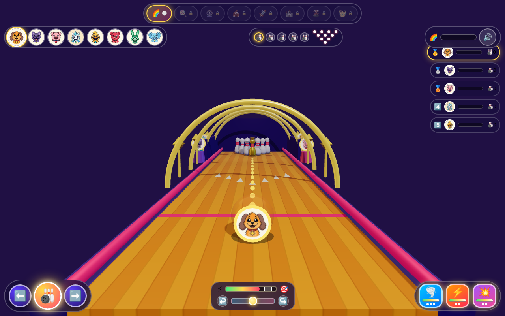

# 🎳🌈 Critter Bowling 3D: Rainbow Strike Alley!



A 100% Zero-Text, kid-friendly **3D WebGL Ten-Pin & Giant Toy Obstacle Bowling Alley** built with **Three.js (`r161`)** featuring all **8 Smiling Critters**, upright 3D portrait medallions inside glossy transparent bowling balls and rival spectator pedestals, a **120Hz fixed-substep 3D physics & domino collision engine**, **3 interactive Power Pedals** (`🌪️` Curve Spin, `⚡` Fireball Strike, `💥` Giant Bomb Ball), **Rainbow Fever Mode (`🌈`)**, and a **5-Critter Tournament** across **8 themed 3D bowling alleys**.

- **Live Game URL**: https://kunruiw1991.github.io/critters-bowling3d/
- **Repository**: https://github.com/kunruiw1991/critters-bowling3d

---

## 🎮 Controls & 100% Zero-Text Visual Cockpit

Every HUD element, gauge, and modal uses purely intuitive icons, emojis, color-coded meters, and animated affordances so young kids can play immediately without reading a single word of text.

| Action / Feature | Desktop Keyboard / Mouse | Mobile / Tablet Touch | Visual Feedback |
| :--- | :--- | :--- | :--- |
| **Aim Left / Right** | `ArrowLeft` / `ArrowRight` or `A` / `D` or Drag Lane | Tap `⬅️` / `➡️` or Drag Left/Right on Lane | Moves 3D Critter Ball & 12-dot parabolic aim arc |
| **Adjust Curve Spin** | Click/Drag `#spin-track` or `↩️` / `↪️` buttons | Tap `↩️` / `↪️` or Drag Spin Slider Knob | Curves dotted trajectory preview & applies spin force |
| **Launch Bowling Ball** | `Space`, `Enter`, `ArrowUp`, `W`, or Swipe Up | Tap pulsing `🎳` Button or Swipe Up on Lane | Launches ball at current `⚡`–`🎯` Power Oscillator level |
| **Pedal 1: Curve Spin (`🌪️`)** | `Digit1` / `Numpad1` or Click `🌪️` Pedal | Tap `🌪️` Pedal (`#pedal-curve`) | Cyan vortex ring + strong homing curve toward standing pins |
| **Pedal 2: Fireball Strike (`⚡`)** | `Digit2` / `Numpad2` or Click `⚡` Pedal | Tap `⚡` Pedal (`#pedal-fireball`) | Blazing gold-orange comet aura + plows through obstacles/pins |
| **Pedal 3: Giant Bomb Ball (`💥`)** | `Digit3` / `Numpad3` or Click `💥` Pedal | Tap `💥` Pedal (`#pedal-bomb`) | 1.45× giant magenta ball + explosive shockwave blast radius |
| **Rainbow Fever Wave (`🌈`)** | `KeyF` or Click `#fever-cluster` (`🌈`) | Tap `#fever-cluster` (`🌈`) when charged | 4-ring rainbow lane wave + 2× pin points + full pedal recharge |
| **Switch Smiling Critter** | Click any of the 8 Critter chips in `#critter-bar` | Tap any Critter portrait chip | Instant 3D ball color/portrait swap & squash-bounce animation |
| **Switch Bowling Alley** | Click any unlocked stage pill (`🌈`..`👑`) | Tap any unlocked stage pill in `#stage-rail` | Rebuilds 3D lane, lighting, props, and stage obstacle course |
| **Podium Next / Retry** | `Space` / `Enter` (Next or Retry), `KeyR` (Retry) | Tap `⏭️` (`#btn-next`) or `🔄` (`#btn-retry`) | Advances on Top-3 qualification (`1st–3rd`) or retries stage |

---

## 🐾 8 Playable Smiling Critters & AI Rival Archetypes

Players can switch between all 8 Smiling Critters at any time (even mid-match without losing tournament progress), while 4 stage-rotated AI rivals compete alongside the lane on 3D pedestals:

1. **🐶 DogDay** (`#ff8c24`) — *All-Rounder*: Balanced strike boost and high consistency.
2. **🐱 CatNap** (`#9b5de5`) — *Curve Master*: High spare conversion and smooth hook control.
3. **🐷 PickyPiggy** (`#ff5ca8`) — *Power Brawler*: Heavy pin carry and energetic celebrations.
4. **🦄 CraftyCorn** (`#38bdf8`) — *Steady Artist*: Highest spare accuracy and low variance.
5. **🐥 KickinChicken** (`#facc15`) — *Hot Streak*: Explosive strike streaks and high flair.
6. **🐻 Bobby BearHug** (`#ef4444`) — *Gentle Roller*: Ultra-reliable lane control.
7. **🐰 Hoppy Hopscotch** (`#22c55e`) — *Speed Striker*: Fast down-lane velocity and high strike rate.
8. **🐘 Bubba Bubbaphant** (`#3b82f6`) — *Tactical Pro*: High spare precision and strategic consistency.

---

## 🌈 8 Themed 3D Bowling Alleys & Progressive Challenge

Each stage features a high-contrast custom lane hardwood palette (`DeltaE > 25`), unique 3D side props, and distinct obstacle mechanics:

1. **Stage 1 (`🌈` Rainbow Alley)**: Open lane with rotating rainbow stars & prism pillars (`aiSkill: 0.24`, kid-friendly 3-star opening stage).
2. **Stage 2 (`🍭` Candy Bumper Lane)**: Striped lollipop trees & springy candy bumpers (`aiSkill: 0.32`, `+1` gold bonus pin).
3. **Stage 3 (`🎡` Windmill Carnival)**: Giant rotating Ferris wheels & spinning windmill blade hub (`aiSkill: 0.38`, `+2` gold bonus pins).
4. **Stage 4 (`🎪` Circus Gate Alley)**: Big-top circus tents & sliding acrobat gates (`aiSkill: 0.44`, `+2` gold bonus pins).
5. **Stage 5 (`🚀` Cosmic Laser Alley)**: Ringed planets, rockets & pulsing laser barrier beams (`aiSkill: 0.50`, `+3` gold bonus pins).
6. **Stage 6 (`🏰` Toy Castle Blocks)**: Castle towers & knockable 3D toy blocks that join the domino chain (`aiSkill: 0.56`, `+3` gold bonus pins).
7. **Stage 7 (`🌋` Volcano Twin Spinners)**: Glowing lava volcano cones & dual counter-rotating spinners (`aiSkill: 0.62`, `+4` gold bonus pins).
8. **Stage 8 (`👑` Royal Gauntlet Finale)**: Golden royal columns, floating crowns, moving gates + spinner gauntlet (`aiSkill: 0.68`, `+5` gold bonus pins).

---

## ⚙️ 3D WebGL Physics, Lighting & Zero-Leak Pool Architecture

- **Three.js `r161` Physically Calibrated Lighting & Shadows**:
  - `PCFSoftShadowMap` (`2048×2048`) directional key light + `PMREMGenerator` studio environment reflections + calibrated `ACESFilmicToneMapping` (`exposure: 0.85`) so saturated lane colors and glossy bowling balls pop without highlight washout.
  - Upright 3D Critter portrait medallion mounted at `local z = +0.96` with `BackSide` power auras so the character portrait is always crisp and visible during both aiming and rolling.
- **120Hz Fixed-Substep Physics & Domino Collision Solver (`FIXED_DT = 1/120`)**:
  - Frame-rate independent accumulator loop (`stepPhysics`) with unified 2D normal/restitution contact solver (`resolveContact`), tangential blade velocity transfer ($\omega \times r$), and a minimum forward down-lane velocity guardrail (`b.vz <= -8.5`) so balls never stall on obstacles.
  - Pin-to-pin domino chain reactions, sunken pin pit (`y = -0.60`), kickback walls (`x = ±4.95`), backboard bounce (`z = -28.6`), Coulomb floor friction, `50ms` impact hit-stop, `0.40s` `0.35×` Strike slow-motion, and `trauma^2` 1D smooth noise camera shake.
- **Zero-Allocation Object Pools & Stage Transition Hygiene**:
  - Pre-allocated `96`-slot 3D star burst pool (`starPool`), `32`-slot floor shockwave ring pool (`ringPool`), and `32`-slot flying 3D star coin pool (`coinPool`) that arcs upward and homes into the player's leaderboard card.
  - `resetActiveParticles()` and `clearStageDisposables()` ensure zero geometry/texture memory leaks and zero leftover in-flight coins across stage switches.
- **Hardware-Timed Web Audio Synthesizer (`SoundEngine`)**:
  - Zero external audio files required; all effects (`playRoll`, dual-oscillator woody `playPinHit`, `playBumperBoing`, `playCoinChime`, `playPedal`, 6-note pentatonic `playFeverChime`, `playStrikeFanfare`, and 4-note trombone slide `playDefeatMotif`) are synthesized in real time on `AudioContext.currentTime`.

---

## 🧪 Local Run & `window.BOWLING_QA` Verification

Serve the directory over HTTP and open in any modern desktop or mobile browser:

```bash
python3 -m http.server 8902 --directory /tmp/critters-bowling3d
```

For automated headless Chrome verification, `window.BOWLING_QA` exposes deterministic inspection and simulation hooks:

- `window.BOWLING_QA.getState()` — Returns live WebGL memory stats (`geometries`, `textures`), `medallionNDC`, `stageIndex`, `unlockedStage`, `starsByStage`, `racers`, `pedals`, `fever`, and pool sizes.
- `window.BOWLING_QA.selectCritter(id)` / `window.BOWLING_QA.selectStage(idx)` — Switches Critter or stage deterministically.
- `window.BOWLING_QA.activatePedal(1 | 2 | 3)` / `window.BOWLING_QA.launchBall()` / `window.BOWLING_QA.stepSim(seconds, fps)` — Runs deterministic fixed-substep bowling roll simulations.
- `window.BOWLING_QA.forceFinish(rank)` — Tests Top-3 Podium Qualification (`rank = 1, 2, 3` -> `3⭐, 2⭐, 1⭐` + stage unlock) vs. 4th/5th Sad Defeat (`rank = 4, 5` -> `0⭐` + Retry only).

---

## 🏆 5-Critter Tournament & Top-3 Qualification Rules

Every match pits the player against **4 stage-rotated AI Smiling Critters** over **5 Ten-Pin Bowling Frames**:
- **🥇 1st Place (`⭐⭐⭐`)**: Unlocks the next bowling alley, triggers 3D lane fireworks, and crowns your Critter on the center gold podium!
- **🥈 2nd Place (`⭐⭐🖤`)**: Qualifies in the Top 3 and unlocks the next bowling alley!
- **🥉 3rd Place (`⭐🖤🖤`)**: Qualifies in the Top 3 and unlocks the next bowling alley!
- **4️⃣ 4th / 5️⃣ 5th Place (`🖤🖤🖤` — Sad Defeat)**: Does **not** unlock the next stage; plays the sympathetic descending trombone motif (`playDefeatMotif()`) and highlights the Retry (`🔄`) button (`#btn-next` is hidden and disabled).

---

## 🔄 10-Round Critic-Creator Iterative Refinement Changelog

1. **Round 1 (3D WebGL Scene Architecture, Lighting/Shadows & Asset Pipeline)**: Enabled `PCFSoftShadowMap` (`2048×2048`), ground-anchored stretched pin contact shadows (`0.02 - pin.y`), calibrated `ACESFilmicToneMapping` (`exposure: 0.85`) with saturated lane albedos, `PMREMGenerator` studio environment, and resilient `THREE.LoadingManager` fallback textures.
2. **Round 2 (8 Smiling Critters Picker, Upright 3D Portrait Medallions & 8 Stage Themes)**: Framed the aiming camera at `(0, 4.2, 19.2)` with `BALL_START_Z = 7.2` and front-mounted `ballPortraitMesh` at `local z = +0.96` (`NDC y ≈ -0.43`), score-preserving mid-match Critter switching with 3D squash-bounce, 4 upright 3D rival billboards on pedestals with leader crown, and 8 distinct stage obstacle/prop builders.
3. **Round 3 (120Hz Core 3D Physics, OBB/Circle Contact Solver & Tactile Impact)**: Implemented `1/120s` fixed-substep physics (`FIXED_DT`), unified 2D normal/restitution `resolveContact()` with tangential spinner velocity ($\omega \times r$), sunken pin pit (`y = -0.60`), kickback walls (`x = ±4.95`), backboard (`z = -28.6`), Coulomb floor friction, `50ms` hit-stop, `0.40s` Strike slow-mo, `trauma^2` 1D smooth noise camera shake, and `96/32/32` zero-allocation star/ring/coin pools.
4. **Round 4 (100% Zero-Text Kid-Friendly Visual Cockpit)**: Enlarged touch targets (`>= 44px`), added interactive `#spin-track` drag slider + `↩️`/`↪️` buttons, `#power-sweetspot` (`🎯`) pulse glow, phase-reactive `#btn-roll` (`.ready-to-bowl` vs. `.rolling-busy`), and elemental armed-pedal aura classes.
5. **Round 5 (3 Interactive Power Pedals & Rainbow Fever Mode `🌈`)**: Added distinct 3D ball auras, spinning `ballVortexRingMesh`, and rolling lane particle/shockwave trails per active power (`0x00e5ff` Curve Spin `🌪️`, `0xff9500` Fireball `⚡`, `0xd946ef` Giant Bomb `💥`, HSL rainbow Fever `🌈`), synchronized overhead 3D arch/rail rainbow wave animation, `triggerRainbowLaneWave()`, and automatic pedal charge regeneration.
6. **Round 6 (4 AI Rivals Behavior, Lively Spectator Animation & Kid-Calibrated Difficulty)**: Calibrated `STAGES` `aiSkill` (`0.24` on Stage 1 up to `0.68` on Stage 8) with Stage 1–2 kid-friendly rubber-banding, per-Critter AI archetypes, Ball 1 + Ball 2 AI rival bowling with 3D pedestal shockwave/star bursts, live status badges (`⚡`, `✨`, `⭐`, `🎳`), and continuous 3D rival idle bob/sway + unison cheering.
7. **Round 7 (Strict 5-Critter Podium & Top-3 Qualification Rules)**: Differentiated `.victory-mode` (`1st–3rd`) vs. `.defeat-mode` (`4th–5th`, `0⭐`, `btnNext.disabled = true`), added `.is-player-podium` crown halo (`👑✨`), `.defeat-highlight` (`😢💔`), 3D podium fireworks, and the Stage 8 Grand Champion crest (`👑🏆🌈🎳🏆👑`).
8. **Round 8 (Procedural Web Audio Synthesizer & Responsive Viewport Layout)**: Upgraded `SoundEngine` to hardware-timed `AudioContext.currentTime` scheduling with dual-oscillator woody `playPinHit()`, 6-note pentatonic harp `playFeverChime()`, `playBumperBoing()`, and 4-note trombone slide `playDefeatMotif()`, plus dynamic portrait `camera.fov` (`syncCameraProjection()`) and `100dvh` / `env(safe-area-inset-*)` / `@media (max-height: 520px)` responsive rules.
9. **Round 9 (End-to-End Polish, Edge-Case Guardrails & Pool Hygiene)**: Added minimum down-lane speed clamp (`b.vz <= -8.5`) in `resolveContact()`, `resetActiveParticles()` on stage transitions, `pointercancel`/`blur` drag resets, and `#podium-modal` keyboard shortcuts (`Space`/`Enter`/`KeyR`).
10. **Round 10 (Final Screenshot Verification & GitHub Pages Deployment)**: Captured `1280×800` live WebGL gameplay screenshot (`screenshot.jpg`), pushed repository to `kunruiw1991/critters-bowling3d`, and deployed live to GitHub Pages.
